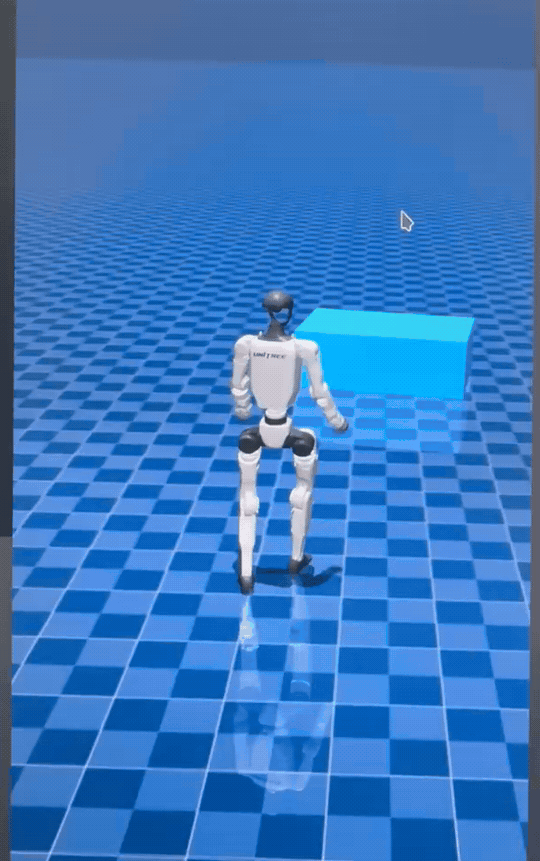

# Parkour MJLab

## Overview

`parkour_mjlab` is a reinforcement learning codebase built on MJLab for perceptive locomotion with Unitree G1 humanoid and Go2 quadruped robots.

## Installation

**Conda environment**

```bash
conda create -n mjlab python=3.11
conda activate mjlab
```

**Install dependencies**
```bash
sudo apt install -y libyaml-cpp-dev libboost-all-dev libeigen3-dev libspdlog-dev libfmt-dev
```

**Install parkour_mjlab**
```bash
git clone https://github.com/yhx1203/parkour_mjlab
```

```bash
cd parkour_mjlab
pip install -e .
```

## Tasks

### 🐕 Go2

<details>
<summary><b>PIE</b></summary>

Train

```bash
python scripts/train.py Unitree-Go2-PIE \
  --agent.run-name stairs
```

Play

```bash
python scripts/play.py \
  --checkpoint-file logs/rsl_rl/go2_pie/model_8000.pt \
  --viewer viser \
  --network-depth-vis \
  --terrain-level 9 \
  --num-envs 1 \
  --device cuda:0
```

Native Sim2Sim

```bash
python deploy/pie/sim2sim/go2_pie_sim2sim.py \
  --checkpoint-file logs/rsl_rl/go2_pie/policy.onnx \
  --provider cpu \
  --terrain stairs \
  --joystick \
  --joystick-type xbox \
  --show-depth
```

</details>


### 🤖️ G1

<details>
<summary><b>PHP</b></summary>

Download the five motion bundles from the
[PHP training motion release](https://github.com/amazon-far/php_parkour/releases/tag/training-motion-examples-v1)
and extract them into `src/assets/motions/php_motion/` with the following directory structure:

```text
src/assets/motions/php_motion/
├── php-motions-high-climb-76-v1/
├── php-motions-high-step-v1/
├── php-motions-locomotion-v1/
├── php-motions-low-climb-76-v1/
└── php-motions-low-step-v1/
```

**Teacher**

Train

```bash
# Train one teacher; replace Locomotion with Low-Climb, High-Step, Low-Step, or High-Climb as needed.
python -m scripts.train \
  Unitree-G1-PHP-Locomotion-Teacher \
  --env.scene.num-envs=2048 \
  --agent.max-iterations=200000 \
  --agent.save-interval=2000 \
  --env.sim.mujoco.ccd-iterations=500 \
  --agent.logger=wandb \
  --agent.wandb-project=php-teachers \
  --agent.run-name=php_locomotion_gpu0
```

Play

```bash
python -m scripts.play \
  Unitree-G1-PHP-Locomotion-Teacher \
  --checkpoint-file="logs/rsl_rl/g1_php_locomotion_teacher/model_20000.pt" \
  --num-envs=1 \
  --motion-id=11 \
  --terrain-variant=0 \
  --viewer=viser 
```

**Student**

Train

```bash
T_LOCOMOTION="logs/rsl_rl/g1_php_locomotion_teacher/model_20000.pt"
T_LOW_STEP="logs/rsl_rl/g1_php_low_step_teacher/model_20000.pt"
T_HIGH_STEP="logs/rsl_rl/g1_php_high_step_teacher/model_20000.pt"
T_LOW_CLIMB="logs/rsl_rl/g1_php_low_climb_teacher/model_20000.pt"
T_HIGH_CLIMB="logs/rsl_rl/g1_php_high_climb_teacher/model_20000.pt"

python -m scripts.train \
  Unitree-G1-PHP-Student \
  --env.scene.num-envs=1024 \
  --agent.teacher-checkpoint-files="('$T_LOCOMOTION', '$T_LOW_STEP', '$T_HIGH_STEP', '$T_LOW_CLIMB', '$T_HIGH_CLIMB')" \
  --agent.max-iterations=30000 \
  --agent.save-interval=1000 \
  --env.sim.mujoco.ccd-iterations=500 \
  --agent.logger=wandb \
  --agent.wandb-project=php-student \
  --agent.run-name=php_student_5teachers
```

Play
```
python -m scripts.play Unitree-G1-PHP-Student \
  --checkpoint-file=logs/rsl_rl/g1_php_student/model_23000.pt \
  --php-skill=High-Climb \
  --terrain-variant=0 \
  --num-envs=1 \
  --viewer=viser 
```

**Sim2sim**
```bash
# Export for native MuJoCo.
python -m deploy.php.sim2sim.export_student_onnx \
  --checkpoint-file logs/rsl_rl/g1_php_student/model_23000.pt \
  --output-file logs/rsl_rl/g1_php_student/model_23000.onnx

# Terminal keyboard control on the three-obstacle course, with policy depth at upper-right.
python -m deploy.php.sim2sim.run_mujoco \
  --policy logs/rsl_rl/g1_php_student/model_23000.onnx \
  --terrain-file deploy/php/sim2sim/assets/custom_obstacles.xml \
  --command-source terminal --show-depth --duration 0
```

W: forward, Q/E: left/right 45°, A/D: left/right 90°, T: walk/run, S: stand, R: reset.
Commands stay active after releasing the key.


Thanks to the [PHP authors](https://github.com/amazon-far/php_parkour) for open-sourcing their work.

</details>

<details>
<summary><b>Amp + Parkour Sim2Sim</b></summary>

```bash
python -m deploy.parkour.sim2sim --gamepad-type xbox --show-depth
```


手柄控制：

- 左摇杆：AMP 前进/横移速度；
- 右摇杆：AMP 转向速度；
- `LB+A`：切到 AMP；
- `LB+Y`：切到 Parkour；
- `LB+B`：重置机器人、回到 AMP。


</details>

<details>
<summary><b>Stair SDK2 Sim2Sim</b></summary>

Install
[`unitree_sdk2_python`](https://github.com/unitreerobotics/unitree_sdk2_python),
then start the MuJoCo server:

```bash
python deploy/stair/sim2sim/unitree_mujoco_stair_server.py \
  --show-depth --domain-id 6 --interface lo --duration 0
```

In a second terminal, start the controller:

```bash
python deploy/stair/sim2sim/g1_stair_unitree_mujoco.py \
  --checkpoint-file logs/rsl_rl/g1_stair/stair_test/policy.onnx \
  --domain-id 6 --interface lo --cmd-x 0.6 --duration 0
```

</details>

## Roadmap

- [x] Release the Go2 PIE training code
- [x] Release the Go2 PIE sim2sim deployment code (MuJoCo)
- [ ] Release the Go2 PIE sim2real deployment code
- [x] Release the G1 Stair sim2sim deployment code (MuJoCo + SDK2)
- [ ] Release the G1 Goal Stair code
- [x] Release the G1 PHP training and sim2sim code
- [ ] Release the G1 AME code
- [ ] Release the G1 CREF code

## Acknowledgements

- [MJLab](https://github.com/mujocolab/mjlab)
- [Isaac Lab](https://github.com/isaac-sim/IsaacLab)
- [unitree_rl_mjlab](https://github.com/unitreerobotics/unitree_rl_mjlab)
- [unitree_mujoco](https://github.com/unitreerobotics/unitree_mujoco)
- [php_parkour](https://github.com/amazon-far/php_parkour)
